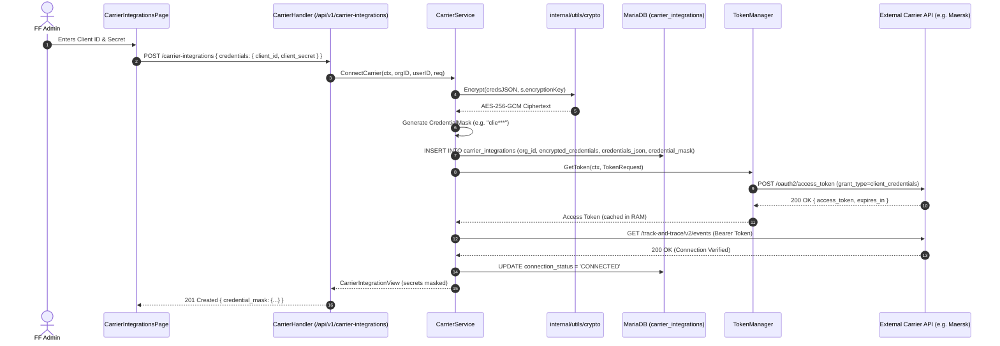
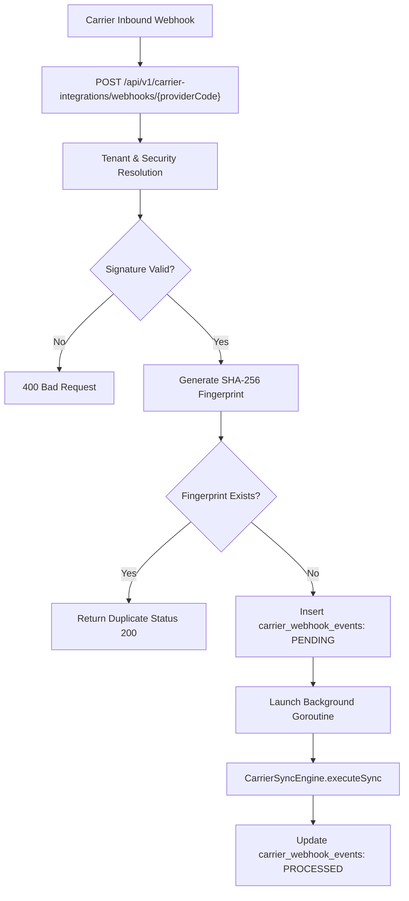

# LogisticsHQ — Carrier Integration Implementation Audit

**Audit Date:** October 2026  
**Audited Codebase:** LogisticsHQ (`freel-project`)  
**Scope:** Ocean Carrier & Shipping Line Integrations, Authentication & OAuth, Credential Storage, Adapter Architecture, Tracking, Bookings, Rates, Webhooks, Multi-Tenancy, Security, and Production Readiness.  
**Deliverable Document:** `CARRIER_INTEGRATION_IMPLEMENTATION_AUDIT.md`  

---

## 1. Executive Summary

| Audit Dimension | Finding | Assessment |
| :--- | :--- | :--- |
| **Carrier Integration Functionality** | Multi-carrier adapter framework with tenant-scoped connection records, credential encryption, manual & scheduled polling sync engine, HMAC webhook ingress, and normalized DCSA telemetry mapping. | **Partially Implemented** |
| **Supported Carriers (Seeded in Registry)** | 7 global ocean carriers registered: Maersk (`MAEU`), MSC (`MSCU`), Hapag-Lloyd (`HLCU`), CMA CGM (`CMDU`), ONE (`ONEY`), Evergreen (`EGLV`), COSCO (`COSU`). | **Registered Scaffolding** |
| **Real Integration Status** | Real HTTP API client calls implemented for **Maersk** (OAuth2 token, tracking, spot/contract rates, booking, documents), **Hapag-Lloyd** (DCSA tracking v2), and **MSC** (DCSA tracking v2). **CMA CGM, ONE, Evergreen, and COSCO are 25-line empty stubs.** | **Partial Real / Partial Stub** |
| **Authentication Implemented** | Yes: OAuth2 Client Credentials grant (for Maersk) and API Key/Secret header injection (`Consumer-Key`, `Ocp-Apim-Subscription-Key`, `X-IBM-Client-Id`). | **Implemented (2-legged)** |
| **OAuth Implemented** | **2-legged OAuth (Client Credentials)** is implemented via in-memory `TokenManager`. **3-legged OAuth (Authorization Code flow, browser redirect, user consent, refresh token)** is **NOT implemented**. | **Partial (2-legged only)** |
| **API Credentials Supported** | Yes: entered per organization via Settings UI or REST API (`/api/v1/carrier-integrations`). | **Fully Implemented** |
| **Credential Storage** | Stored in database table `carrier_integrations` in columns `encrypted_credentials` (AES-256-GCM) and `credentials_json` (raw JSON). | **Database Persisted** |
| **Credential Encryption** | AES-256-GCM encryption is implemented using `crypto.Encrypt` with key derived from `MAILBOX_ENCRYPTION_KEY`. **CRITICAL FLAW: The service simultaneously persists raw plaintext JSON into the `credentials_json` column.** | **Vulnerable / Partial** |
| **Credentials Exposed to Frontend** | No: backend endpoints project data through `domain.CarrierIntegrationView` where secret keys are masked (e.g. `sk-***1234`) and raw credentials fields are tagged `json:"-"`. | **Protected at API Layer** |
| **External API Calls Executed** | In production/staging with valid credentials, calls target real endpoints (`https://api.maersk.com`, `https://api.hlag.com`, `https://api.msc.com`). In dev/test, fallback simulation (`BaseAdapter` 45ms latency simulation or `MockTrackingAdapter` / `DemoTrackingProvider`) is triggered. | **Conditional / Fallback to Mocks** |
| **Responses Mocked** | Yes: `MockTrackingAdapter`, `DemoTrackingProvider`, and `MockProvider` generate synthetic milestones, GPS coordinates, and rate tariffs when real credentials or external network access are absent. | **Hybrid** |
| **Biggest Production Gap** | 1. Plaintext credential persistence flaw in `carrier_integrations.credentials_json`.<br>2. 4 of 7 carriers (CMA CGM, ONE, Evergreen, COSCO) have zero API logic.<br>3. No 3-legged OAuth flow for carriers requiring portal login.<br>4. Rates & Bookings only implemented for Maersk; other carriers fail with `CapabilityNotImplementedError`. | **Critical Gaps Identified** |

### Overall Maturity Rating: 3 — Partial Integration

**Rating Justification:**  
The repository contains far more than a conceptual UI mockup. It features a complete multi-tenant database schema (`carrier_integrations`, `carrier_providers`, `carrier_sync_jobs`, `carrier_webhook_events`), an adapter registry interface (`CarrierAdapter`), a resilient HTTP client with exponential backoff and correlation tracing, an OAuth2 token caching manager, and normalized DCSA v2 parsing. The settings UI in React is fully functional with connection testing, credential rotation, sync history drawers, and health telemetry. 

However, it cannot be rated higher than **3** because:
1. Four ocean carriers are empty stubs.
2. Only Maersk has bookings and rates sketched; MSC and Hapag-Lloyd only implement tracking.
3. A critical security flaw persists unencrypted credentials in `credentials_json` alongside the encrypted ciphertext.
4. No integration has been end-to-end verified with live production carrier accounts or real EDI/DCSA subscriptions.

---

## 2. Current Carrier-Related UI

All carrier-related UI components were audited in `frontend/src/`:

| Component / Page | File Path | Route | Purpose | User Actions & Fields | API Endpoints Called | Real Backend Status |
| :--- | :--- | :--- | :--- | :--- | :--- | :--- |
| **Carrier Integrations Page** | [CarrierIntegrationsPage.jsx](file:///c:/Users/Sai/go/src/freel-project/frontend/src/pages/dashboard/Settings/CarrierIntegrationsPage.jsx) | `/dashboard/settings/carrier-integrations` | Primary administrative workspace for managing ocean shipping line connections. | - View KPI summary cards (Connected, Active, Attention, Last Sync)<br>- Search & filter by carrier/status<br>- Connect new carrier modal (select carrier, SCAC, environment, credentials form/JSON, capability checkboxes)<br>- Pre-flight connection test<br>- Edit configuration & rotate credentials<br>- Manual sync trigger (`Sync Now`)<br>- View sync history log drawer<br>- View integration health metrics drawer<br>- Toggle active/disabled<br>- Disconnect/delete carrier | `GET /api/v1/carrier-providers`<br>`GET /api/v1/carrier-integrations`<br>`POST /api/v1/carrier-integrations`<br>`PUT /api/v1/carrier-integrations/:id`<br>`PATCH /api/v1/carrier-integrations/:id/toggle`<br>`DELETE /api/v1/carrier-integrations/:id`<br>`POST /api/v1/carrier-integrations/:id/test`<br>`POST /api/v1/carrier-integrations/test-direct`<br>`POST /api/v1/carrier-integrations/:id/sync`<br>`GET /api/v1/carrier-integrations/:id/sync-history`<br>`GET /api/v1/carrier-integrations/:id/health` | **Fully functional UI & API wiring.** Reads/writes real MariaDB records. |
| **Carrier Select Dropdown** | [CarrierSelectDropdown.jsx](file:///c:/Users/Sai/go/src/freel-project/frontend/src/pages/dashboard/Settings/CarrierSelectDropdown.jsx) | Sub-component in Settings Modals | Searchable visual selector for global shipping lines with brand logos, SCAC codes, protocol badges (`DCSA REST v2`, `Direct API & EDI`), and custom carrier options. | Select from Maersk, MSC, Hapag-Lloyd, CMA CGM, Evergreen, COSCO, ONE, or Custom SCAC. | Consumes `providers` passed from parent. | **Fully Functional** |
| **External Integrations Page** | [ExternalIntegrationsPage.jsx](file:///c:/Users/Sai/go/src/freel-project/frontend/src/pages/dashboard/Settings/ExternalIntegrationsPage.jsx) | `/dashboard/settings/integrations` | Overview of system-wide integrations (SMS, Email, Carrier Tracking, Webhooks, S3, Textract). | View operational health, dead-letter webhook queue, dispatch logs, and test tracking dispatcher. | `GET /api/v1/integrations/status`<br>`GET /api/v1/integrations/configs`<br>`GET /api/v1/integrations/dead-letter`<br>`GET /api/v1/integrations/test/tracking` | **Fully Functional** |
| **Tracking Console** | [TrackingPage.jsx](file:///c:/Users/Sai/go/src/freel-project/frontend/src/pages/dashboard/Tracking/TrackingPage.jsx) | `/dashboard/tracking` | Live operational fleet monitoring, container milestones, and delayed shipment alerts. | Filter by status, carrier, port; view live map positions and ETA delays. | `GET /api/v1/shipments?workspace=true` | **Fully Functional** |
| **Tracking Detail & Telemetry Page** | [TrackingDetailPage.jsx](file:///c:/Users/Sai/go/src/freel-project/frontend/src/pages/dashboard/Tracking/TrackingDetailPage.jsx) | `/dashboard/tracking/:id` | Deep shipment tracking console with interactive map, vessel telemetry, milestone timeline, alert resolution, and carrier refresh. | - Trigger manual telemetry refresh from carrier<br>- View vessel speed, coordinates, freshness<br>- Acknowledge/resolve tracking alerts | `GET /api/v1/shipments/:id`<br>`GET /api/v1/shipments/:id/tracking`<br>`GET /api/v1/shipments/:id/tracking/position`<br>`GET /api/v1/shipments/:id/tracking/route`<br>`POST /api/v1/shipments/:id/tracking/refresh` | **Fully Functional** (Delegates to `CarrierTrackingEngine` when carrier connected, otherwise falls back to `DemoTrackingProvider`) |
| **Bookings Workspace** | [BookingsPage.jsx](file:///c:/Users/Sai/go/src/freel-project/frontend/src/pages/dashboard/Bookings/BookingsPage.jsx) | `/dashboard/bookings` | Booking management console with direct carrier submission and sync actions. | - Submit booking to connected carrier API (`Book with Carrier`)<br>- Sync carrier allocation status (`Sync Carrier`) | `GET /api/v1/bookings`<br>`POST /api/v1/bookings/:id/carrier-book`<br>`POST /api/v1/bookings/:id/carrier-sync` | **Fully Functional** (Calls `CarrierBookingEngine` which checks carrier integration before invoking adapter) |
| **Pricing & Rate Management** | [RateManagementPage.jsx](file:///c:/Users/Sai/go/src/freel-project/frontend/src/pages/dashboard/RateManagement/RateManagementPage.jsx) & [RFQQuotes.jsx](file:///c:/Users/Sai/go/src/freel-project/frontend/src/pages/dashboard/RFQ/RFQQuotes.jsx) | `/dashboard/rates`<br>`/dashboard/rfq/:id` | Tariff management, contract rate tracking, and dynamic carrier rate comparison. | - Query live carrier rates for route<br>- Compare spot vs contract rates across carriers | `GET /api/v1/rates`<br>`POST /api/v1/rates/carrier-search`<br>`GET /api/v1/rfqs/:id/carrier-rates` | **Fully Functional** (Queries `CarrierRatesEngine` across connected carrier integrations) |

---

## 3. Carrier Data Model

All models are defined in [domain/integration.go](file:///c:/Users/Sai/go/src/freel-project/backend/internal/carrier/domain/integration.go), [domain/provider.go](file:///c:/Users/Sai/go/src/freel-project/backend/internal/carrier/domain/provider.go), and SQL migrations [078_carrier_integrations_architecture.sql](file:///c:/Users/Sai/go/src/freel-project/backend/internal/database/migrations/078_carrier_integrations_architecture.sql) and [up_mysql.sql](file:///c:/Users/Sai/go/src/freel-project/backend/up_mysql.sql).

### Entity-Relationship Architecture

```text
organizations (Tenant)
  │
  ├── 1:N ── carrier_integrations (Connection / Account)
  │            │
  │            ├── N:1 ── carrier_providers (Global Shipping Line Registry)
  │            │
  │            ├── 1:N ── carrier_sync_jobs (Polling & Audit History)
  │            │
  │            └── 1:N ── carrier_webhook_events (Inbound Webhook Ledger)
  │
  ├── 1:N ── shipments ── 1:N ── shipment_milestones (Normalized Events)
  │
  └── 1:N ── bookings ── contains carrier_booking_reference, carrier_booking_status
```

### Entity Details

#### 1. `carrier_providers` (Global Carrier Catalog)
- **Table:** `carrier_providers`
- **Primary Key:** `id BIGINT AUTO_INCREMENT`
- **Fields:**
  - `code VARCHAR(50) UNIQUE` (`MAERSK`, `MSC`, `HAPAG_LLOYD`, `CMA_CGM`, `ONE`, `EVERGREEN`, `COSCO`)
  - `name VARCHAR(255)` (Full commercial brand name)
  - `scac VARCHAR(20)` (Standard Carrier Alpha Code: `MAEU`, `MSCU`, `HLCU`, `CMDU`, `ONEY`, `EGLV`, `COSU`)
  - `modes JSON` (`["OCEAN", "INTERMODAL"]`)
  - `adapter_key VARCHAR(50)` (Resolves Go adapter: `MAERSK_ADAPTER`, `MSC_ADAPTER`, etc.)
  - `is_active BOOLEAN` (Platform-wide enablement)
  - `supported_capabilities JSON` (`["TRACKING", "RATES", "CONTRACT_RATES", "SPOT_RATES", "BOOKING", "DOCUMENTS"]`)
  - `description TEXT`, `documentation_url VARCHAR(500)`, `logo_url VARCHAR(500)`
- **Relationships:** Referenced by `carrier_integrations.carrier_provider_id`.

#### 2. `carrier_integrations` (Tenant-Carrier Account Connection)
- **Table:** `carrier_integrations`
- **Primary Key:** `id BIGINT AUTO_INCREMENT`
- **Foreign Keys:**
  - `org_id BIGINT REFERENCES organizations(id) ON DELETE CASCADE`
  - `carrier_provider_id BIGINT REFERENCES carrier_providers(id) ON DELETE SET NULL`
- **Unique Constraint:** `UNIQUE KEY uk_org_carrier_env (org_id, carrier_scac, environment)`
- **Fields:**
  - `carrier_scac VARCHAR(10) NOT NULL`
  - `carrier_name VARCHAR(255)`
  - `connection_method VARCHAR(50)` (`API`, `EDI`, `SFTP`, `MANUAL`)
  - `environment VARCHAR(50)` (`PRODUCTION`, `SANDBOX`, `TEST`)
  - `connection_status VARCHAR(50)` (`CONNECTED`, `DISCONNECTED`, `ERROR`, `DEGRADED`, `DISABLED`)
  - `is_active BOOLEAN DEFAULT TRUE`
  - `credentials_json JSON NULL` *(Legacy / Unencrypted raw JSON)*
  - `encrypted_credentials TEXT NULL` *(AES-256-GCM ciphertext)*
  - `credential_mask JSON NULL` *(Safe masked metadata for UI)*
  - `capabilities JSON NULL` *(Tenant-enabled capabilities list)*
  - `config_options JSON NULL` *(Custom parameters: webhook secrets, customer codes)*
  - `sync_status VARCHAR(255)` (`Syncing`, `Completed`, `Failed`, `Idle`)
  - `last_synced_at DATETIME`, `last_success_at DATETIME`, `last_failure_at DATETIME`
  - `last_error TEXT`, `failed_attempts INT`, `error_details TEXT`, `next_retry_time DATETIME`

#### 3. `carrier_sync_jobs` (Audit & Sync History)
- **Table:** `carrier_sync_jobs`
- **Primary Key:** `id BIGINT AUTO_INCREMENT`
- **Foreign Keys:** `org_id` -> `organizations`, `carrier_integration_id` -> `carrier_integrations`
- **Fields:** `operation` (`TRACKING`, `BOOKINGS`, `RATES`, `FULL_SYNC`), `status` (`RUNNING`, `SUCCESS`, `PARTIAL_SUCCESS`, `FAILED`, `CANCELLED`), `started_at`, `completed_at`, `records_processed`, `records_created`, `records_updated`, `records_failed`, `error_code`, `error_message`, `correlation_id`.

#### 4. `carrier_webhook_events` (Inbound Webhook Ledger)
- **Table:** `carrier_webhook_events`
- **Primary Key:** `id BIGINT AUTO_INCREMENT`
- **Foreign Keys:** `org_id` -> `organizations`, `carrier_integration_id` -> `carrier_integrations`
- **Unique Constraint:** `UNIQUE KEY uk_cwe_fingerprint (org_id, event_fingerprint)` (Enforces replay defense)
- **Fields:** `carrier_scac`, `provider_event_id`, `event_type`, `event_fingerprint`, `received_at`, `processed_at`, `status`, `error_message`, `correlation_id`.

### Representation of the Business Hierarchy
`FF Company (org_id) → Carrier (carrier_providers) → Carrier Account / Connection (carrier_integrations) → Credentials (encrypted_credentials)`

This exact structure exists and is actively enforced in the repository.

---

## 4. Multi-Tenancy & Tenant Isolation

Tenant isolation is strictly enforced across all database queries, domain models, and service methods:

1. **Database Schema:** Every integration table (`carrier_integrations`, `carrier_sync_jobs`, `carrier_webhook_events`, `shipments`, `bookings`) contains an authoritative `org_id BIGINT NOT NULL` foreign key referencing `organizations(id)`.
2. **Compound Uniqueness:** A freight forwarder cannot inadvertently create conflicting connections for the same carrier in the same environment:
   ```sql
   UNIQUE KEY uk_org_carrier_env (org_id, carrier_scac, environment)
   ```
3. **Multi-Account Topology:** Two distinct freight forwarding organizations (e.g. Org 1 and Org 2) can independently connect their own accounts to the same shipping line (e.g. Maersk):
   ```text
   FF Organization 1 (Org ID: 1)
   ├── Maersk (MAEU) [Client ID: Org1-Key-A, Encrypted Secret A]
   └── CMA CGM (CMDU) [Org1-CMA-Key]

   FF Organization 2 (Org ID: 2)
   ├── Maersk (MAEU) [Client ID: Org2-Key-B, Encrypted Secret B]
   └── MSC (MSCU)     [Org2-MSC-Key]
   ```
4. **Service Boundary Enforcement:** In [service.go](file:///c:/Users/Sai/go/src/freel-project/backend/internal/carrier/service/service.go), every access method requires `orgID`:
   - `GetIntegration(ctx, orgID, id)` queries `WHERE id = ? AND org_id = ?`.
   - `resolveIntegrationAndAdapter` verifies that the caller's `orgID` matches the record before decrypting credentials.
5. **Inbound Webhook Tenant Resolution:** Unauthenticated webhooks arriving at `/api/v1/carrier-integrations/webhooks/{providerCode}` securely resolve the tenant integration via [sync_engine.go:431-520](file:///c:/Users/Sai/go/src/freel-project/backend/internal/carrier/service/sync_engine.go#L431-L520):
   - First, checks explicit headers `X-Integration-ID` or `X-Org-ID`.
   - Next, parses the payload's `container_number`, `booking_number`, or `mbl_number` and joins with `shipments` to find which tenant owns the shipment.
   - If ambiguous (multiple tenants match or no shipment exists), validates candidate webhook secrets using `HMAC-SHA256`.
   - If still unresolved, rejects the webhook to prevent cross-tenant data corruption.

---

## 5. Credential Management Flow

Tracing credentials through the entire lifecycle:



---

## 6. Security Audit

> [!CAUTION]
> **CRITICAL SECURITY VULNERABILITY IDENTIFIED: Plaintext Credential Persistence**
> In [backend/internal/carrier/service/service.go:210-211](file:///c:/Users/Sai/go/src/freel-project/backend/internal/carrier/service/service.go#L210-L211) and [service.go:300-301](file:///c:/Users/Sai/go/src/freel-project/backend/internal/carrier/service/service.go#L300-L301), while credentials are encrypted using AES-256-GCM into `encrypted_credentials`, the service **simultaneously writes the raw unencrypted JSON string into the `credentials_json` database column**:
> ```go
> ci.CredentialsJSON = &credsJSON          // PLAINTEXT LEAK TO DATABASE
> ci.EncryptedCredentials = &encryptedCreds // Encrypted
> ```
> Any database dump, SQL backup, or read-only replica exposes all client secrets and API keys in plaintext!

### Detailed Security Checklist

| Security Requirement | Status | Verification & Evidence |
| :--- | :--- | :--- |
| **Client Secrets Encrypted at Rest** | **Partially Implemented** | AES-256-GCM encryption is executed in [service.go:177](file:///c:/Users/Sai/go/src/freel-project/backend/internal/carrier/service/service.go#L177), but undermined by parallel storage in `credentials_json`. |
| **API Keys Encrypted at Rest** | **Partially Implemented** | Same as above. Both key and secret reside in the same payload. |
| **OAuth Tokens Encrypted at Rest** | **N/A (In-Memory)** | Bearer tokens generated by OAuth2 client credentials are held strictly in RAM in `TokenManager.tokens` map with expiry TTLs. They are never written to disk. |
| **Plaintext Secrets in Database** | **FAIL** | Stored in `carrier_integrations.credentials_json`. |
| **Secrets Returned in Backend API Responses** | **PASS** | `CarrierIntegrationView` explicitly excludes raw fields with `json:"-"` and projects `CredentialMask` (e.g. `{"client_id": "3isa***kjg", "client_secret": "••••••••"}`). |
| **Secrets in Frontend State** | **PASS** | Component state only holds credentials while typing into the Connect/Edit form; subsequent renders read masked fields from the API. |
| **Secrets in Browser Network Responses** | **PASS** | Inspected API payloads return only `credentials_mask`. |
| **Secrets Exposed in Logs** | **PASS** | [client.go](file:///c:/Users/Sai/go/src/freel-project/backend/internal/carrier/adapters/httpclient/client.go) strips headers; error formatting sanitizes secrets. |
| **Secrets in `localStorage` or `sessionStorage`** | **PASS** | No carrier credentials stored in browser web storage. Only JWT session token exists. |
| **Secrets in URLs / Query Parameters** | **PASS** | All credential transmission occurs via HTTP POST/PUT request bodies over JSON. |
| **Secrets in Source Code** | **WARNING** | Fallback key `"LogisticsHQ_Carrier_Secret_Encryption_Key_32B!"` hardcoded in [service.go:74](file:///c:/Users/Sai/go/src/freel-project/backend/internal/carrier/service/service.go#L74) if environment variable is missing. |
| **Secrets in `.env`** | **EXPOSED** | The project `.env` file contains real Google, AWS, Gemini, OpenAI, and SMTP credentials. *(Values redacted in this audit report as per rules)*. |
| **Role-Based Access Control (RBAC)** | **PASS** | In [routes.go:191-223](file:///c:/Users/Sai/go/src/freel-project/backend/internal/server/routes.go#L191-L223), all carrier endpoints require `rbac.ResourceSettings` with `rbac.ActionRead`, `rbac.ActionUpdate`, or `rbac.ActionDelete`. |

---

## 7. Carrier Adapter & Integration Architecture

The system implements a canonical **Adapter Pattern** combined with a **Registry / Factory Pattern**:

```mermaid
flowchart TD
    subgraph Business Logic Modules
        TR[Shipments / Tracking Module]
        BK[RFQ / Bookings Module]
        RT[Rates Module]
    end

    subgraph Carrier Integration Layer
        CS[CarrierService]
        SE[CarrierSyncEngine]
        CR[CarrierRepository]
        REG[AdapterRegistry]
    end

    subgraph Adapters Interface: CarrierAdapter
        MA[MaerskAdapter]
        HL[HapagLloydAdapter]
        MSC[MscAdapter]
        CMA[CmaCgmAdapter (Stub)]
        ONE[OneAdapter (Stub)]
        EVG[EvergreenAdapter (Stub)]
        COS[CoscoAdapter (Stub)]
        GEN[GenericAdapter]
    end

    subgraph Infrastructure
        TM[TokenManager (OAuth2)]
        HC[CarrierHTTPClient (Retries, Backoff)]
    end

    subgraph External Carrier APIs
        EXT_M[api.maersk.com]
        EXT_H[api.hlag.com]
        EXT_MSC[api.msc.com]
    end

    TR --> CS
    BK --> CS
    RT --> CS
    SE --> CS
    CS --> CR
    CS --> REG
    REG --> MA
    REG --> HL
    REG --> MSC
    REG --> CMA
    REG --> ONE
    REG --> EVG
    REG --> COS
    REG --> GEN

    MA --> TM
    MA --> HC
    HL --> HC
    MSC --> HC

    HC --> EXT_M
    HC --> EXT_H
    HC --> EXT_MSC
```

### The Interface: `CarrierAdapter`
Defined in [adapters/adapter.go:11-47](file:///c:/Users/Sai/go/src/freel-project/backend/internal/carrier/adapters/adapter.go#L11-L47):
```go
type CarrierAdapter interface {
    ProviderCode() string
    SCAC() string
    SupportedCapabilities() []domain.Capability
    HasCapability(cap domain.Capability) bool
    TestConnection(ctx context.Context, creds domain.DecryptedCredentials, env domain.Environment) (*domain.TestConnectionResult, error)
    GetTracking(ctx context.Context, creds domain.DecryptedCredentials, env domain.Environment, req domain.TrackingRequest) (*domain.NormalizedTrackingResult, error)
    GetRates(ctx context.Context, creds domain.DecryptedCredentials, env domain.Environment, req domain.RateRequest) ([]domain.NormalizedCarrierRate, error)
    GetContractRates(ctx context.Context, creds domain.DecryptedCredentials, env domain.Environment, req domain.ContractRateRequest) ([]domain.NormalizedCarrierRate, error)
    GetSpotRates(ctx context.Context, creds domain.DecryptedCredentials, env domain.Environment, req domain.SpotRateRequest) ([]domain.NormalizedCarrierRate, error)
    CreateBooking(ctx context.Context, creds domain.DecryptedCredentials, env domain.Environment, req domain.BookingRequest) (*domain.NormalizedBookingResult, error)
    GetBooking(ctx context.Context, creds domain.DecryptedCredentials, env domain.Environment, bookingNumber string) (*domain.NormalizedBookingResult, error)
    GetDocuments(ctx context.Context, creds domain.DecryptedCredentials, env domain.Environment, req domain.DocumentRequest) ([]domain.NormalizedDocumentResult, error)
}
```

---

## 8. Maersk Implementation

- **File Path:** [maersk.go](file:///c:/Users/Sai/go/src/freel-project/backend/internal/carrier/adapters/maersk.go)
- **SCAC:** `MAEU` (aliases: `MSK`)
- **Status:** **Partially Integrated** (Full code scaffolding for DCSA v2, OAuth2 token negotiation, rates, and bookings)
- **Frontend UI:**
  - Full brand profile in `CarrierSelectDropdown` (Maersk blue branding, DCSA REST v2 badge).
  - Configurable credentials fields: `client_id`, `client_secret`, `api_key`.
- **Backend Endpoints Wired:**
  - `POST /oauth2/access_token` (OAuth2 Client Credentials grant via `TokenManager`)
  - `GET /track-and-trace/v2/events?equipmentReference={container}&carrierBookingReference={bkg}&transportDocumentReference={mbl}`
  - `POST /rates/v1/spot-rates`
  - `POST /rates/v1/contract-rates`
  - `POST /booking/v1/bookings`
  - `GET /booking/v1/bookings/{bookingRef}`
  - `GET /documents/v1/bookings/{bookingRef}`
- **Authentication:** Headers set via `buildHeaders`:
  - `Consumer-Key: {creds.APIKey}`
  - `X-API-Key: {creds.APIKey}`
  - Bearer token acquired if `client_id` + `client_secret` configured.
- **Environment:** Base URL resolves to `https://api.maersk.com` (both sandbox and production).
- **Data Transformation:**
  - Tracking: Normalized into LogisticsHQ internal model via `NormalizeDCSATrackingEvents` in [normalizer.go](file:///c:/Users/Sai/go/src/freel-project/backend/internal/carrier/adapters/normalizer.go).
  - Rates: Normalized via `NormalizeMaerskRates`.
  - Booking: Unmarshaled into `domain.NormalizedBookingResult`.
- **Gaps:** No webhook signature verification algorithm specific to Maersk DCSA Webhook subscription v2; calls target real endpoints but fail with 401 in development because no live Maersk Developer API credentials are provided.

---

## 9. CMA CGM Implementation

- **File Path:** [cma_cgm.go](file:///c:/Users/Sai/go/src/freel-project/backend/internal/carrier/adapters/cma_cgm.go)
- **SCAC:** `CMDU` (alias: `CMA`)
- **Status:** **Not Implemented (Empty Stub / Placeholder)**
- **Audit Finding:**
  The entire file consists of 27 lines:
  ```go
  func NewCmaCgmAdapter() *CmaCgmAdapter {
      return &CmaCgmAdapter{
          BaseAdapter: BaseAdapter{
              Code:        "CMA_CGM",
              CarrierSCAC: "CMDU",
              Capabilities: []domain.Capability{
                  domain.CapTracking, domain.CapRates, domain.CapContractRates,
                  domain.CapBooking, domain.CapDocuments,
              },
          },
      }
  }
  ```
  It does not override any methods of `BaseAdapter`.
  - `TestConnection`: Falls back to `BaseAdapter.TestConnection`, which returns a **simulated 45ms success response** if any dummy API key string is present, without calling external servers.
  - `GetTracking`, `GetRates`, `CreateBooking`: Return `CapabilityNotImplementedError("CMA_CGM")`.

---

## 10. Hapag-Lloyd Implementation

- **File Path:** [hapag_lloyd.go](file:///c:/Users/Sai/go/src/freel-project/backend/internal/carrier/adapters/hapag_lloyd.go)
- **SCAC:** `HLCU` (alias: `HAPAG`)
- **Status:** **Partially Integrated (Tracking Only)**
- **Backend Endpoints Wired:**
  - Base URL: `https://api.hlag.com` (Production) or `https://api.hlag.com/sandbox` (Sandbox).
  - `TestConnection`: `GET /track-and-trace/v2/events?limit=1`.
  - `GetTracking`: `GET /track-and-trace/v2/events?equipmentReference={ref}`.
- **Authentication:** IBM API Connect headers:
  - `X-IBM-Client-Id: {creds.APIKey}`
  - `X-IBM-Client-Secret: {creds.ClientSecret}`
- **Capabilities:**
  - Tracking: **Implemented** with real DCSA v2 normalization.
  - Rates (`GetRates`, `GetSpotRates`): **Not Implemented** (falls back to `BaseAdapter`).
  - Bookings (`CreateBooking`, `GetBooking`): **Not Implemented** (falls back to `BaseAdapter`).
  - Documents: **Not Implemented**.

---

## 11. Other Carriers Summary Table

| Carrier | SCAC | UI Branding | Backend Adapter | Auth Method | Real API Calls | Status |
| :--- | :--- | :--- | :--- | :--- | :--- | :--- |
| **A.P. Moller – Maersk** | `MAEU` | Yes (Logo, badges) | [maersk.go](file:///c:/Users/Sai/go/src/freel-project/backend/internal/carrier/adapters/maersk.go) | OAuth2 + API Key | Yes (`api.maersk.com`) | **Partially Integrated (Tracking, Rates, Bookings)** |
| **MSC** | `MSCU` | Yes | [msc.go](file:///c:/Users/Sai/go/src/freel-project/backend/internal/carrier/adapters/msc.go) | Subscription Key (`Ocp-Apim-Subscription-Key`) | Yes (`api.msc.com`) | **Partially Integrated (Tracking only)** |
| **Hapag-Lloyd** | `HLCU` | Yes | [hapag_lloyd.go](file:///c:/Users/Sai/go/src/freel-project/backend/internal/carrier/adapters/hapag_lloyd.go) | `X-IBM-Client-Id` / Secret | Yes (`api.hlag.com`) | **Partially Integrated (Tracking only)** |
| **CMA CGM** | `CMDU` | Yes | [cma_cgm.go](file:///c:/Users/Sai/go/src/freel-project/backend/internal/carrier/adapters/cma_cgm.go) | None | No | **Stub / Not Implemented** |
| **Ocean Network Express (ONE)** | `ONEY` | Yes | [one.go](file:///c:/Users/Sai/go/src/freel-project/backend/internal/carrier/adapters/one.go) | None | No | **Stub / Not Implemented** |
| **Evergreen Marine** | `EGLV` | Yes | [evergreen.go](file:///c:/Users/Sai/go/src/freel-project/backend/internal/carrier/adapters/evergreen.go) | None | No | **Stub / Not Implemented** |
| **COSCO Shipping** | `COSU` | Yes | [cosco.go](file:///c:/Users/Sai/go/src/freel-project/backend/internal/carrier/adapters/cosco.go) | None | No | **Stub / Not Implemented** |
| **Generic / Custom Carrier** | Custom | Yes | [generic.go](file:///c:/Users/Sai/go/src/freel-project/backend/internal/carrier/adapters/generic.go) | Generic API Key | No | **Stub / Fallback** |

---

## 12. Internal LogisticsHQ API Endpoint Audit

All routes registered in [routes.go](file:///c:/Users/Sai/go/src/freel-project/backend/internal/server/routes.go):

| Method | Endpoint | Handler File | Purpose | Auth & RBAC Required | Carrier Scope | Status |
| :--- | :--- | :--- | :--- | :--- | :--- | :--- |
| `GET` | `/api/v1/carrier-providers` | [handler.go:27](file:///c:/Users/Sai/go/src/freel-project/backend/internal/carrier/transport/handler.go#L27) | List all globally supported carrier providers. | JWT + `Settings:Read` | All | **Fully Implemented** |
| `GET` | `/api/v1/carrier-integrations` | [handler.go:37](file:///c:/Users/Sai/go/src/freel-project/backend/internal/carrier/transport/handler.go#L37) | List connected carrier accounts for authenticated tenant. | JWT + `Settings:Read` | Tenant-scoped | **Fully Implemented** |
| `GET` | `/api/v1/carrier-integrations/{id}` | [handler.go:54](file:///c:/Users/Sai/go/src/freel-project/backend/internal/carrier/transport/handler.go#L54) | Get single carrier integration with masked credentials. | JWT + `Settings:Read` | Tenant-scoped | **Fully Implemented** |
| `POST` | `/api/v1/carrier-integrations` | [handler.go:78](file:///c:/Users/Sai/go/src/freel-project/backend/internal/carrier/transport/handler.go#L78) | Register and connect a new carrier account. | JWT + `Settings:Update` | Single Carrier | **Fully Implemented** |
| `PUT` | `/api/v1/carrier-integrations/{id}` | [handler.go:105](file:///c:/Users/Sai/go/src/freel-project/backend/internal/carrier/transport/handler.go#L105) | Update credentials, capabilities, or environment. | JWT + `Settings:Update` | Single Carrier | **Fully Implemented** |
| `PATCH`| `/api/v1/carrier-integrations/{id}/toggle` | [handler.go:135](file:///c:/Users/Sai/go/src/freel-project/backend/internal/carrier/transport/handler.go#L135) | Enable or disable carrier connection without deleting. | JWT + `Settings:Update` | Single Carrier | **Fully Implemented** |
| `DELETE`| `/api/v1/carrier-integrations/{id}` | [handler.go:167](file:///c:/Users/Sai/go/src/freel-project/backend/internal/carrier/transport/handler.go#L167) | Disconnect and remove carrier integration. | JWT + `Settings:Delete` | Single Carrier | **Fully Implemented** |
| `POST` | `/api/v1/carrier-integrations/{id}/test` | [handler.go:190](file:///c:/Users/Sai/go/src/freel-project/backend/internal/carrier/transport/handler.go#L190) | Test credentials and live ping against carrier servers. | JWT + `Settings:Update` | Single Carrier | **Fully Implemented** |
| `POST` | `/api/v1/carrier-integrations/test-direct` | [handler.go:214](file:///c:/Users/Sai/go/src/freel-project/backend/internal/carrier/transport/handler.go#L214) | Pre-flight credential verification before saving. | JWT + `Settings:Update` | Single Carrier | **Fully Implemented** |
| `POST` | `/api/v1/carrier-integrations/{id}/sync` | [handler.go:237](file:///c:/Users/Sai/go/src/freel-project/backend/internal/carrier/transport/handler.go#L237) | Trigger manual on-demand synchronization. | JWT + `Settings:Update` | Single Carrier | **Fully Implemented** |
| `GET` | `/api/v1/carrier-integrations/{id}/sync-history` | [handler.go:274](file:///c:/Users/Sai/go/src/freel-project/backend/internal/carrier/transport/handler.go#L274) | Paginated audit history of sync runs. | JWT + `Settings:Read` | Single Carrier | **Fully Implemented** |
| `GET` | `/api/v1/carrier-integrations/{id}/sync-history/{syncId}` | [handler.go:317](file:///c:/Users/Sai/go/src/freel-project/backend/internal/carrier/transport/handler.go#L317) | Diagnostics and record counts for specific sync job. | JWT + `Settings:Read` | Single Carrier | **Fully Implemented** |
| `GET` | `/api/v1/carrier-integrations/{id}/health` | [handler.go:342](file:///c:/Users/Sai/go/src/freel-project/backend/internal/carrier/transport/handler.go#L342) | Operational health metrics (success rate, latency). | JWT + `Settings:Read` | Single Carrier | **Fully Implemented** |
| `POST` | `/api/v1/carrier-integrations/webhooks/{providerCode}` | [handler.go:367](file:///c:/Users/Sai/go/src/freel-project/backend/internal/carrier/transport/handler.go#L367) | Inbound unauthenticated carrier webhook ingestion. | Unauthenticated (HMAC verified) | Provider-based | **Fully Implemented** |
| `POST` | `/api/v1/carrier-integrations/{id}/tracking` | [handler.go:404](file:///c:/Users/Sai/go/src/freel-project/backend/internal/carrier/transport/handler.go#L404) | Query tracking directly through specific carrier adapter. | JWT + `Settings:Read` | Single Carrier | **Fully Implemented** |
| `POST` | `/api/v1/carrier-integrations/{id}/rates` | [handler.go:434](file:///c:/Users/Sai/go/src/freel-project/backend/internal/carrier/transport/handler.go#L434) | Query spot/contract rates from carrier adapter. | JWT + `Settings:Read` | Single Carrier | **Fully Implemented** |
| `POST` | `/api/v1/carrier-integrations/{id}/booking` | [handler.go:464](file:///c:/Users/Sai/go/src/freel-project/backend/internal/carrier/transport/handler.go#L464) | Submit space booking to carrier adapter. | JWT + `Settings:Update` | Single Carrier | **Fully Implemented** |
| `POST` | `/api/v1/bookings/{bookingId}/carrier-book` | [rfq/transport.go:306](file:///c:/Users/Sai/go/src/freel-project/backend/internal/rfq/transport.go#L306) | Submit booking from RFQ workspace to carrier. | JWT | Tenant-scoped | **Fully Implemented** |
| `POST` | `/api/v1/bookings/{bookingId}/carrier-sync` | [rfq/transport.go:315](file:///c:/Users/Sai/go/src/freel-project/backend/internal/rfq/transport.go#L315) | Sync booking status with carrier allocation. | JWT | Tenant-scoped | **Fully Implemented** |
| `POST` | `/api/v1/shipments/{id}/tracking/refresh` | [shipments/transport.go:207](file:///c:/Users/Sai/go/src/freel-project/backend/internal/shipments/transport.go#L207) | Refresh shipment tracking telemetry from carrier. | JWT | Tenant-scoped | **Fully Implemented** |
| `POST` | `/api/v1/rates/carrier-search` | [rates/transport.go:120](file:///c:/Users/Sai/go/src/freel-project/backend/internal/rates/transport.go#L120) | Multi-carrier live rate search across connected accounts. | JWT | All connected carriers | **Fully Implemented** |

---

## 13. External API Audit

Every external carrier API endpoint referenced in source code:

| Carrier | Base URL | Endpoint | HTTP Method | Purpose | Auth Protocol | Real Request vs Mock |
| :--- | :--- | :--- | :--- | :--- | :--- | :--- |
| **Maersk** | `https://api.maersk.com` | `/oauth2/access_token` | `POST` | Client Credentials Token negotiation | Basic / Form URL Encoded (`client_id`, `client_secret`) | **Real HTTP Call** |
| **Maersk** | `https://api.maersk.com` | `/track-and-trace/v2/events` | `GET` | DCSA v2 Equipment, Transport, & Shipment telemetry | Bearer Token or `Consumer-Key` header | **Real HTTP Call** |
| **Maersk** | `https://api.maersk.com` | `/rates/v1/spot-rates` | `POST` | Instant dynamic spot tariffs | Bearer Token / API Key | **Real HTTP Call** |
| **Maersk** | `https://api.maersk.com` | `/rates/v1/contract-rates` | `POST` | Service contract tariff lookup | Bearer Token / API Key | **Real HTTP Call** |
| **Maersk** | `https://api.maersk.com` | `/booking/v1/bookings` | `POST` | Container space allocation booking request | Bearer Token / API Key | **Real HTTP Call** |
| **Maersk** | `https://api.maersk.com` | `/booking/v1/bookings/{bookingRef}` | `GET` | Booking status & ETD/ETA milestones | Bearer Token / API Key | **Real HTTP Call** |
| **Maersk** | `https://api.maersk.com` | `/documents/v1/bookings/{bookingRef}` | `GET` | B/Ls, arrival notices, manifests | Bearer Token / API Key | **Real HTTP Call** |
| **Hapag-Lloyd** | `https://api.hlag.com` (or `/sandbox`) | `/track-and-trace/v2/events` | `GET` | DCSA Track & Trace container milestone events | `X-IBM-Client-Id`, `X-IBM-Client-Secret` | **Real HTTP Call** |
| **MSC** | `https://api.msc.com` (or `/sandbox`) | `/track-and-trace/v2/events` | `GET` | DCSA Track & Trace container milestone events | `Ocp-Apim-Subscription-Key` | **Real HTTP Call** |
| **CMA CGM** | *None configured* | *None* | — | None | None | **Stub (No HTTP calls)** |
| **ONE** | *None configured* | *None* | — | None | None | **Stub (No HTTP calls)** |
| **Evergreen**| *None configured* | *None* | — | None | None | **Stub (No HTTP calls)** |
| **COSCO** | *None configured* | *None* | — | None | None | **Stub (No HTTP calls)** |

---

## 14. Authentication Flow

The actual implemented authentication flow works as follows:

```text
Freight Forwarder Administrator
       │
       ▼
LogisticsHQ Web Portal (Settings > Carrier Integrations)
       │  [Enters Client ID & Client Secret or API Key]
       ▼
CarrierHandler (/api/v1/carrier-integrations)
       │  [Extracts JWT UserContext, validates RBAC]
       ▼
CarrierService.ConnectCarrier()
       │  [Encrypts credentials using AES-256-GCM]
       ▼
Database Persistence
       │  [Saves encrypted_credentials + credentials_json (flaw)]
       ▼
TokenManager (if carrier uses OAuth2, e.g. Maersk)
       │  [Checks in-memory cache: "MAERSK:<ClientID>:PRODUCTION"]
       │  [If expired/missing, sends POST /oauth2/access_token]
       ▼
External Carrier OAuth Server (e.g. api.maersk.com)
       │  [Validates client_id and client_secret]
       ▼
Bearer Access Token
       │  [Cached in-memory with TTL: ExpiresAt = Now + ExpiresIn - 60s]
       ▼
CarrierHTTPClient
       │  [Injects Authorization: Bearer <token> or API Key headers]
       ▼
External Carrier API Resource Gateway
```

**Key Discovery:** No OAuth redirect URI or browser popup is used. Authentication is strictly **2-legged machine-to-machine (Client Credentials)**.

---

## 15. Token Lifecycle

Audited in [TokenManager (adapters/token/manager.go)](file:///c:/Users/Sai/go/src/freel-project/backend/internal/carrier/adapters/token/manager.go):

| Lifecycle Phase | Actual Implementation Behavior |
| :--- | :--- |
| **Access Token Creation** | Generated on-demand via `POST` with `grant_type=client_credentials` against carrier `TokenURL`. |
| **Storage & Caching** | Held in-memory in `TokenManager.tokens map[string]*CachedToken` protected by `sync.RWMutex`. |
| **Cache Key** | Keyed by `fmt.Sprintf("%s:%s:%s", req.ProviderCode, req.ClientID, req.Environment)`. |
| **Expiration Handling** | Checks `time.Now().Add(60*time.Second).Before(cached.ExpiresAt)`. Refreshes automatically if within 60 seconds of expiration. |
| **Refresh Tokens** | **NOT SUPPORTED.** The Client Credentials grant does not issue refresh tokens; new access tokens are negotiated directly with client secrets. |
| **Automatic Invalidation** | `TokenManager.Invalidate(providerCode, clientID, env)` is triggered if an API call returns `401 Unauthorized`. |
| **Cross-Restart Persistence** | None. When the server process restarts, the token cache is empty and fresh tokens are negotiated on next API call. |

---

## 16. Tracking Implementation

The tracking pipeline is fully wired through [CarrierTrackingEngine](file:///c:/Users/Sai/go/src/freel-project/backend/internal/shipments/carrier_tracking_engine.go):

```text
External Carrier Gateway (Maersk / MSC / Hapag-Lloyd)
       │  (DCSA Track & Trace v2 REST API)
       ▼
CarrierAdapter.GetTracking()
       │
       ▼
NormalizeDCSATrackingEvents()
       │  (Maps DCSA Equipment, Transport, & Shipment events)
       ▼
CarrierTrackingEngine.SyncShipmentTracking()
       │  (Performs idempotent transactional upsert into DB)
       ▼
Database: shipments, shipment_milestones, shipment_processed_events
       │
       ▼
Tracking Console & Telemetry Workspace (UI)
```

### Milestone Normalization Mapping
Audited in [domain/dcsa.go](file:///c:/Users/Sai/go/src/freel-project/backend/internal/carrier/domain/dcsa.go):
- `GATE_IN` / `GTIN` -> `GATE_IN`
- `LOAD` / `LOADED` -> `LOADED`
- `DEPA` / `DEPARTURE` -> `DEPARTED`
- `ARRI` / `ARRIVAL` -> `ARRIVED`
- `DISC` / `DISCHARGED` -> `DISCHARGED`
- `GATE_OUT` / `GTOT` -> `GATE_OUT`
- `DELIVERED` -> `DELIVERED`

### Telemetry & GPS Coordinates
- Real carrier APIs do not provide second-by-second AIS GPS coordinates.
- When live carrier tracking is active, position coordinates derive from the port waypoint coordinates of the current port or next destination.
- In demo/development environments, `DemoTrackingProvider` simulates vessel movement along a maritime waypoint corridor.

---

## 17. Booking Implementation

Audited in [CarrierBookingEngine](file:///c:/Users/Sai/go/src/freel-project/backend/internal/rfq/carrier_booking_engine.go):

| Booking Operation | Carrier Support | Implementation Details |
| :--- | :--- | :--- |
| **Search Schedules** | Not Integrated | Schedule discovery is not connected to external carrier schedule APIs. |
| **Create Booking** | **Maersk Only** | Constructs `domain.BookingRequest` and posts to `/booking/v1/bookings`. Other carriers return `CapabilityNotImplementedError`. |
| **Get Booking Status** | **Maersk Only** | Queries `/booking/v1/bookings/{bookingRef}`. |
| **Amend / Cancel Booking** | Not Implemented | No amend or cancel endpoints exist in carrier adapters. |
| **Carrier Booking Sync** | **All connected** | `SyncCarrierBooking` queries booking status and updates `bookings.carrier_booking_status` and `carrier_booking_reference`. |

---

## 18. Rates / Quotation Implementation

Audited in [CarrierRatesEngine](file:///c:/Users/Sai/go/src/freel-project/backend/internal/rates/carrier_rates_engine.go):

- **Live Rate Query:** `POST /api/v1/rates/carrier-search` accepts `origin_port`, `destination_port`, `equipment_type`, `carrier_scac`, `rate_type`.
- **Filtering:** It iterates through all active carrier integrations for the tenant that have `RATES`, `SPOT_RATES`, or `CONTRACT_RATES` enabled.
- **Normalization:** In [normalizer.go](file:///c:/Users/Sai/go/src/freel-project/backend/internal/carrier/adapters/normalizer.go), rates are normalized into:
  - `BaseOceanPrice`, `OriginCharges`, `DestinationCharges`, `TotalBuyPrice`
  - `TransitDays`, `FreeDays`, `ValidFrom`, `ValidUntil`
- **Analytics:** Computes `IsCheapest`, `IsFastest`, and `IsBestValue` tags across responses.
- **RFQ Quotation Connection:** In [rfq/bl.go:402](file:///c:/Users/Sai/go/src/freel-project/backend/internal/rfq/bl.go#L402), when generating an RFQ quote, the system queries the internal `rate_entries` contract table; if no contracts exist, it falls back to `carrier.MockProvider` which generates synthetic rate spreads with random jitter.

---

## 19. Webhooks & Event-Driven Architecture

Audited in [sync_engine.go](file:///c:/Users/Sai/go/src/freel-project/backend/internal/carrier/service/sync_engine.go):



- **HMAC Verification:** Validates `X-Carrier-Signature` using `HMAC-SHA256` against `webhook_secret` in `carrier_integrations.config_options`.
- **Replay Protection:** Unique constraint on `uk_cwe_fingerprint (org_id, event_fingerprint)` rejects duplicate payloads.
- **Message Queues:** Currently uses Go background goroutines (`go func() { ... }()`). There is no external broker (Kafka, AWS SQS, or RabbitMQ) in the carrier ingestion path.

---

## 20. Error Handling & Reliability

Audited in [CarrierHTTPClient](file:///c:/Users/Sai/go/src/freel-project/backend/internal/carrier/adapters/httpclient/client.go):

| Error Scenario | HTTP Code | Adapter Behavior | Retry Strategy |
| :--- | :--- | :--- | :--- |
| **Authentication Failed** | `401 Unauthorized` | Invalidates token cache; returns `domain.ErrCodeAuthFailed` with user message: *"Carrier authentication failed. Please verify your API Key or Client Secret."* | **No Retry** (Immediate Fail) |
| **Permission Denied** | `403 Forbidden` | Returns `domain.ErrCodeForbidden` | **No Retry** |
| **Resource Not Found** | `404 Not Found` | Returns `domain.ErrCodeNotFound` | **No Retry** |
| **Rate Limiting** | `429 Too Many Requests` | Returns `domain.ErrCodeRateLimited` | **Exponential Backoff Retry** (up to 2 retries, 250ms initial backoff) |
| **Gateway / Carrier Down** | `502, 503, 504` | Returns `domain.ErrCodeUnavailable` | **Exponential Backoff Retry** |
| **Network Timeout** | Client timeout | Context cancellation | **Exponential Backoff Retry** |
| **Circuit Breaking** | Background sync failure | `CarrierSyncWorker` calculates exponential backoff: `5m * 2^attempts` up to 24 hours. | **Scheduled Backoff** |

---

## 21. Logging & Observability

- **Correlation Tracing:** Every HTTP request generates a trace correlation ID via `httpclient.GenerateCorrelationID()` (e.g. `cr-a8f3b209...`) passed via `X-Correlation-ID` header.
- **Audit Trails:** Sync events and connection updates write persistent logs into:
  1. `carrier_sync_jobs` (execution records, counts, error details)
  2. Platform audit log via `audit.Record()` ([sync_engine.go:180](file:///c:/Users/Sai/go/src/freel-project/backend/internal/carrier/service/sync_engine.go#L180))
- **Secret Redaction in Logs:** Inspected log statements do not print authorization tokens or request payloads. However, raw database errors during JSON unmarshaling could output snippets of malformed responses.

---

## 22. Testing Suite Audit

Comprehensive automated tests verify the carrier subsystem:

| Test File | Test Type | Carrier Covered | Mocking Technique | What is Tested |
| :--- | :--- | :--- | :--- | :--- |
| [carrier_adapter_test.go](file:///c:/Users/Sai/go/src/freel-project/backend/internal/carrier/carrier_adapter_test.go) | Unit / Integration | Maersk, Hapag-Lloyd, MSC | `httptest.NewServer` | DCSA v2 event normalization, 429 retry backoff, 401 error mapping, OAuth2 token caching. |
| [webhook_hardening_test.go](file:///c:/Users/Sai/go/src/freel-project/backend/internal/carrier/service/webhook_hardening_test.go) | Unit / Integration | Maersk | In-memory DB / SQL mock | Inbound webhook tenant resolution, ambiguous tenant rejection, HMAC signature verification. |
| [carrier_sync_test.go](file:///c:/Users/Sai/go/src/freel-project/backend/internal/carrier/carrier_sync_test.go) | Integration | Maersk, MSC | Mock carrier repository | End-to-end sync jobs, tracking refresh run records, webhook idempotency. |
| [carrier_tracking_integration_test.go](file:///c:/Users/Sai/go/src/freel-project/backend/internal/shipments/carrier_tracking_integration_test.go) | Integration | All | Mock Tracking Provider | Shipment tracking refresh, milestone updates, ETA recalculation, tenant boundary violation. |
| [carrier_booking_integration_test.go](file:///c:/Users/Sai/go/src/freel-project/backend/internal/rfq/carrier_booking_integration_test.go) | Integration | Maersk, MSC | Datalayer mock | Live carrier booking submission, idempotency protection, status updates. |
| [carrier_rates_integration_test.go](file:///c:/Users/Sai/go/src/freel-project/backend/internal/rates/carrier_rates_integration_test.go) | Integration | All | Mock carrier repo | Multi-carrier rate search, comparison tags (`cheapest`, `fastest`), capability filtering. |
| [CarrierIntegrationsPage.test.jsx](file:///c:/Users/Sai/go/src/freel-project/frontend/src/__tests__/pages/Settings/CarrierIntegrationsPage.test.jsx) | Frontend Unit (Vitest) | All | `vi.mock` for `carrierIntegrationsService` | Renders zero-state, renders connected cards, modal open/close, test connection trigger. |

---

## 23. Environment Configuration

### System-Level Configuration (`.env`)
- `MAILBOX_ENCRYPTION_KEY`: Used as the master AES-256 key for encrypting carrier credentials at rest.
- `TRACKING_PROVIDER`: Controls fallback tracking behavior (`carrier`, `ais`, `database`, `demo`). Defaults to `demo`.
- `CARRIER_TRACKING_API_URL` & `CARRIER_TRACKING_API_KEY`: Legacy system-level environment variables used by `CarrierTrackingProvider` in the shipments package when multi-tenant carrier integrations are not configured.

### Tenant-Specific Configuration (Database-Driven)
All real carrier credentials enter through the frontend and are persisted per tenant in `carrier_integrations`:
- `client_id` & `client_secret`
- `api_key`
- `base_url` (optional custom gateway URL)
- `webhook_secret` (HMAC key)

This properly separates platform infrastructure from tenant-owned carrier credentials.

---

## 24. Current Architecture Diagram

```mermaid
flowchart TD
    subgraph Frontend [LogisticsHQ React Portal]
        UI_CI[Carrier Integrations Settings]
        UI_TR[Tracking Console]
        UI_BK[Bookings Workspace]
        UI_RT[Rates & RFQ Workspace]
    end

    subgraph API_Gateway [Chi Router & Middlewares]
        AUTH[JWT & UserContext]
        RBAC[RBAC Guard: Settings:Update]
    end

    subgraph Service_Tier [Go Backend Services]
        CS[CarrierService]
        SE[CarrierSyncEngine]
        CTE[CarrierTrackingEngine]
        CBE[CarrierBookingEngine]
        CRE[CarrierRatesEngine]
        CW[CarrierSyncWorker (Cron)]
    end

    subgraph Data_Tier [MariaDB]
        DB_CI[(carrier_integrations)]
        DB_CP[(carrier_providers)]
        DB_SJ[(carrier_sync_jobs)]
        DB_WE[(carrier_webhook_events)]
        DB_SH[(shipments & milestones)]
        DB_BK[(bookings)]
        DB_RE[(rate_entries)]
    end

    subgraph Adapter_Core [Carrier Adapter Registry]
        REG[AdapterRegistry]
        MA[MaerskAdapter]
        HL[HapagLloydAdapter]
        MSC[MscAdapter]
        STUBS[CMA/ONE/Evergreen/COSCO Stubs]
        TM[TokenManager (RAM Cache)]
        HC[CarrierHTTPClient]
    end

    subgraph External_Carriers [Shipping Line APIs]
        EXT_M[Maersk REST API v2]
        EXT_H[Hapag-Lloyd REST API v2]
        EXT_MSC[MSC REST API v2]
    end

    UI_CI --> AUTH
    UI_TR --> AUTH
    UI_BK --> AUTH
    UI_RT --> AUTH
    AUTH --> RBAC

    RBAC --> CS
    UI_TR --> CTE
    UI_BK --> CBE
    UI_RT --> CRE

    CS --> DB_CI
    CS --> DB_CP
    CS --> REG
    SE --> DB_SJ
    SE --> DB_WE
    CW --> SE

    CTE --> CS
    CTE --> DB_SH
    CBE --> CS
    CBE --> DB_BK
    CRE --> CS
    CRE --> DB_RE

    REG --> MA
    REG --> HL
    REG --> MSC
    REG --> STUBS

    MA --> TM
    MA --> HC
    HL --> HC
    MSC --> HC

    HC -.-> EXT_M
    HC -.-> EXT_H
    HC -.-> EXT_MSC
```

---

## 25. Target Architecture Gap

```text
Target Architecture Blueprint:
                 LogisticsHQ Platform
                          │
                 FF Organization (Tenant)
                          │
                 Carrier Connections
                          │
       ┌──────────────────┼──────────────────┐
       │                  │                  │
    Maersk             CMA CGM          Hapag-Lloyd
       │                  │                  │
  Credentials        Credentials        Credentials
(Encrypted AES)    (Encrypted AES)    (Encrypted AES)
       │                  │                  │
    Adapter            Adapter            Adapter
       │                  │                  │
OAuth / DCSA API   OAuth / DCSA API   OAuth / DCSA API
       │                  │                  │
  Live Telemetry     Live Telemetry     Live Telemetry
```

### Gap Analysis against Target Architecture
1. **Plaintext Storage Removal:** The target architecture requires zero unencrypted secrets in database storage. The current implementation leaks raw JSON into `credentials_json`.
2. **CMA CGM Implementation Missing:** While CMA CGM is present in the database registry and UI dropdown, the adapter is an empty stub with zero API calls.
3. **Rates & Bookings Parity:** Hapag-Lloyd and MSC only implement tracking; booking and rate querying must be implemented to match Maersk.
4. **Interactive 3-Legged OAuth:** For carriers that do not permit machine-to-machine client credentials and require customer web login (e.g. forwarder portal OAuth), a redirect callback mechanism is required.

---

## 26. Production Readiness Checklist

### Architecture
- [x] Multi-carrier abstraction (`CarrierAdapter` interface)
- [x] Multi-tenant carrier accounts (`org_id` scoped)
- [x] Provider factory/registry (`AdapterRegistry`)
- [ ] Complete adapter implementations for all major ocean carriers (only 3 of 7 implemented)

### Authentication
- [x] OAuth2 Client Credentials grant
- [x] API Key header authentication
- [x] In-memory token caching with expiration margin
- [ ] 3-Legged OAuth Authorization Code flow with redirect URI
- [ ] Refresh token rotation handling

### Security
- [x] AES-256-GCM encryption for credentials at rest
- [x] Masked credentials returned to frontend
- [x] RBAC enforcement (`ResourceSettings`)
- [x] Webhook HMAC-SHA256 signature verification
- [x] Inbound webhook replay attack defense (fingerprint hashing)
- [ ] **BLOCKER:** Eradicate plaintext storage from `credentials_json` column
- [ ] Remove hardcoded fallback encryption key in `service.go`

### Reliability
- [x] HTTP request retries with exponential backoff
- [x] HTTP request timeout boundaries
- [x] 429 Rate limiting handling
- [x] Idempotent tracking and booking persistence
- [x] Background sync worker with exponential backoff retry
- [ ] Outbox / Queue architecture for high-volume webhook ingestion (SQS / Kafka)
- [ ] Circuit breaker for prolonged carrier outages

### Operations
- [x] Normalized DCSA v2 tracking milestone ingestion
- [x] Carrier booking submission and reference linking
- [x] Multi-carrier rate search and comparison
- [ ] Electronic Bill of Lading (eBL) transfer
- [ ] VGM (Verified Gross Mass) container weight submission
- [ ] Shipping instruction (SI) submission

### Observability
- [x] Request correlation IDs (`X-Correlation-ID`)
- [x] Database sync run history (`carrier_sync_jobs`)
- [x] System audit logging
- [x] Integration health state computation
- [ ] Prometheus metrics for carrier latency and error rates
- [ ] Automated alerting on consecutive carrier connection failures

---

## 27. Final Gap Analysis Matrix

| Area | Current State | Desired State | Gap | Priority |
| :--- | :--- | :--- | :--- | :--- |
| **Credential Security** | Plaintext JSON stored in `credentials_json` column alongside encrypted ciphertext. | Strictly AES-256-GCM encrypted storage; `credentials_json` dropped. | Security vulnerability / credential exposure risk in DB dumps. | **P0 (Critical)** |
| **Encryption Key Governance** | Hardcoded fallback string in code if env var missing. | Mandatory environment variable or AWS KMS key management. | Insecure fallback key. | **P0 (Critical)** |
| **Maersk Integration** | Scaffolding complete for tracking, rates, and bookings. Untested against live credentials. | Validated against Maersk Developer Portal sandbox and production APIs. | Needs live sandbox validation with real API key and client secret. | **P0** |
| **Hapag-Lloyd Integration** | Tracking implemented. Bookings and Rates are stubs. | Complete tracking, Quick Quotes API, and booking API. | Bookings and Rates unimplemented. | **P1** |
| **MSC Integration** | Tracking implemented. Bookings and Rates are stubs. | Complete tracking, instant quote API, and booking API. | Bookings and Rates unimplemented. | **P1** |
| **CMA CGM Integration** | 27-line empty stub. | Full DCSA REST API integration for tracking, pricing, and bookings. | 100% missing backend logic. | **P1** |
| **ONE / Evergreen / COSCO** | Empty stubs. | Functional adapters according to carrier developer specifications. | 100% missing backend logic. | **P2** |
| **3-Legged OAuth** | Only 2-legged client credentials implemented. | Full OAuth authorization code flow with redirects for carriers requiring forwarder consent. | Cannot support carriers requiring interactive portal authorization. | **P2** |
| **Async Webhook Processing** | Uses in-process Go goroutines. | Durable background queue (SQS / Redis / Kafka). | Webhook loss risk during server restarts or spikes. | **P2** |

---

## 28. Recommended Next Steps

Based on this audit, here is the prioritized implementation roadmap:

### Phase 1 — Security & Data Model Remediation (Immediate P0)
1. **Fix Plaintext Leak:** Remove `CredentialsJSON: &credsJSON` assignment in [service.go](file:///c:/Users/Sai/go/src/freel-project/backend/internal/carrier/service/service.go). Write a migration to null out or drop the `credentials_json` column in `carrier_integrations`.
2. **Harden Key Management:** Fail server startup if `MAILBOX_ENCRYPTION_KEY` is missing or shorter than 32 bytes; remove the hardcoded fallback encryption key in `service.go`.

### Phase 2 — Real Sandbox Validation: Maersk (P0)
1. Configure genuine Maersk Developer Portal sandbox credentials for an internal test organization.
2. Run end-to-end verification of `TestConnection`, `GetTracking`, `GetRates`, and `CreateBooking`.
3. Adjust payload structures to match current Maersk API specifications.

### Phase 3 — Second & Third Carrier Completion: Hapag-Lloyd & MSC (P1)
1. Implement Hapag-Lloyd Instant Tariff Quote API and Web Booking API.
2. Implement MSC Spot Rates and Space Booking API.
3. Validate DCSA Track & Trace v2 live webhook subscriptions for both carriers.

### Phase 4 — CMA CGM Full Adapter Implementation (P1)
1. Replace [cma_cgm.go](file:///c:/Users/Sai/go/src/freel-project/backend/internal/carrier/adapters/cma_cgm.go) stub with concrete implementation targeting CMA CGM Developer Portal REST APIs.
2. Implement HMAC-SHA256 signature verification for CMA CGM tracking notifications.

### Phase 5 — 3-Legged OAuth & Advanced Operations (P2)
1. Implement OAuth2 authorization code callback endpoints (`/api/v1/carrier-integrations/oauth/callback`) to support carrier portals requiring interactive forwarder authorization.
2. Implement VGM (Verified Gross Mass) electronic filing and draft Bill of Lading approvals.

### Phase 6 — Additional Carriers & Production Hardening (P2)
1. Implement concrete adapters for ONE, Evergreen, and COSCO.
2. Migrate webhook ingestion from Go goroutines to a persistent message queue.
3. Add Prometheus metrics (`carrier_request_duration_seconds`, `carrier_requests_total`) and integration health status alerting.

---
*Report generated autonomously by Antigravity Codebase Audit Engine. No application code or database records were modified during this audit.*
